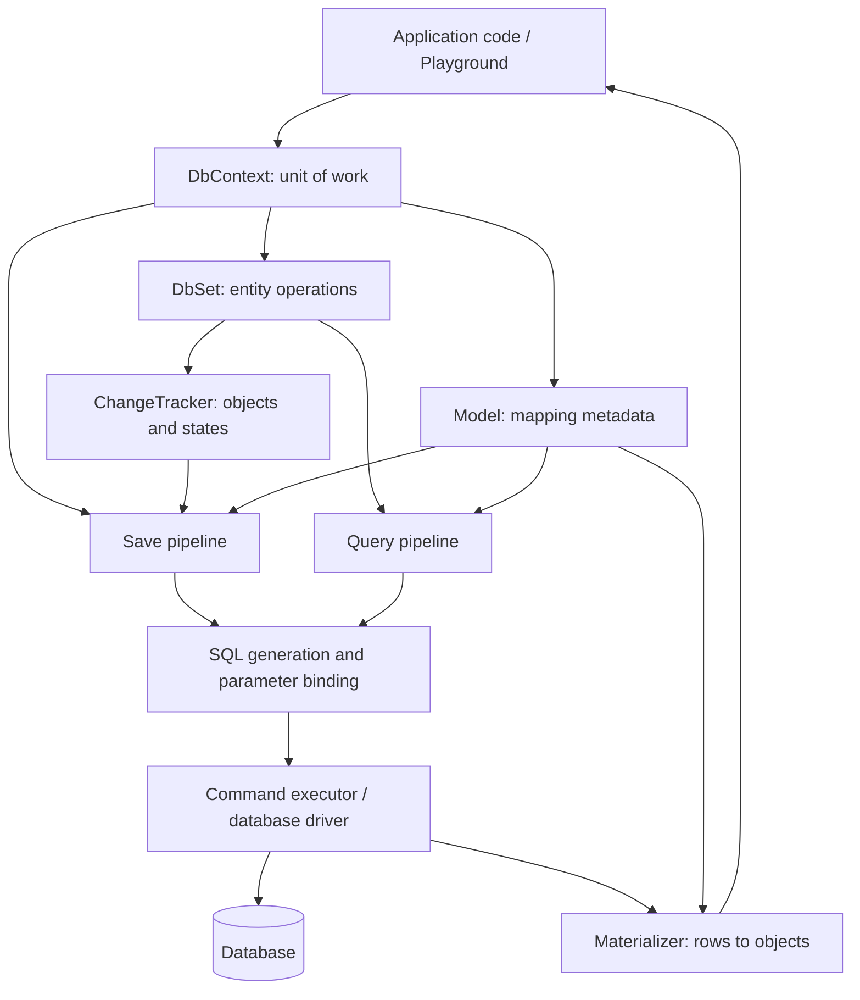

# MiniEFCore: Build an ORM Framework from Scratch

This project is a small ORM built from scratch to explore how a framework discovers application entities, tracks object changes, generates SQL, and turns query results into objects. It does not reference Microsoft Entity Framework Core. The `DbContext` and `DbSet<T>` types here are our own implementations.

This document describes the design of this project, not an exact reproduction of EF Core internals. Start with a minimal version whose behavior is easy to explain and verify, then expand it gradually.

## 1. What an ORM Does

ORM stands for Object-Relational Mapping. It connects C# objects to relational database structures:

| C# | Database |
|---|---|
| Entity class `TaskItem` | Table `TaskItems` |
| Property `Title` | Column `Title` |
| One `TaskItem` object | One row |
| Primary key property `Id` | Primary key column `Id` |

The framework handles conversion in both directions:

```text
Write: objects and their changes → commands and parameters → INSERT / UPDATE / DELETE
Read: query conditions → SELECT → data rows → C# objects
```

We implement these conversions. A database driver handles communication with the database, while the database engine stores data, executes SQL, and manages transactions. Building an ORM does not require building a database driver or database engine.

## 2. The Two Roles in This Project

```text
MiniEFCore/
├── MiniEFCore.slnx
├── src/
│   └── MiniEFCore/                 Framework used by different applications
│       ├── DbContext.cs
│       └── DbSet.cs
└── samples/
    └── MiniEFCore.Playground/      Consumer that exercises the framework
        ├── AppDbContext.cs
        ├── TaskItem.cs
        └── Program.cs
```

The framework project must not reference the Playground or hard-code `TaskItem` into its implementation. It should handle any entity type that meets its supported conventions. The Playground references the framework, declares entities, and calls the framework API.

`AppDbContext` is the application's configuration entry point. `DbContext` is the reusable base class we implement. They connect through inheritance and ordinary method calls.

## 3. Overall Architecture



| Component | Core question | Initial responsibility |
|---|---|---|
| `DbContext` | What coordinates the components? | Own configuration, the model, cached sets, and the tracker; expose `Set<T>()` and `SaveChanges()` |
| `DbSet<T>` | How does an application operate on one entity type? | Expose operations such as `Add`, `Remove`, and `Find`, delegating to the context's internal services |
| Model discovery and building | How does the framework understand application classes? | Discover entities and properties through reflection; apply conventions for keys and table names |
| Model metadata | Where is the discovered structure stored? | Describe entity types, tables, columns, keys, and property access |
| `ChangeTracker` | Which objects need to be inserted, updated, or deleted? | Store object references and entity states; later capture snapshots of original values |
| SQL generator | How do operations become SQL? | Use mappings to generate parameterized inserts, updates, deletes, and simple queries |
| Command executor | What connects to the database and executes commands? | Use a database driver; manage parameters, transactions, and resources |
| `Materializer` | How do query results become objects? | Create entities, convert column values, and assign properties |

Keep these components small initially. Introduce interfaces when a second implementation or a need to isolate behavior in tests makes them useful, rather than adding an interface for every class immediately.

## 4. Registration, Reflection, Callbacks, and Execution

### 4.1 Registration Is an Optional Way to Assemble Objects

The first version does not need `AddDbContext` or a dependency injection container. Creating an instance with `new AppDbContext(...)` is enough to exercise the ORM's core behavior. DI integration can later take responsibility for creating and disposing of contexts.

Registration stores creation rules. Calling context methods executes operations. Registration alone does not query the database.

### 4.2 Reflection Discovers Type Structure

The application declares:

```csharp
public DbSet<TaskItem> TaskItems => Set<TaskItem>();
```

This is a target API; the current skeleton does not implement `Set<T>()` yet.

The model discovery component inspects the properties of `AppDbContext`, finds those whose type is `DbSet<>`, and extracts the generic argument `TaskItem`. Reading property metadata does not require executing the property's getter.

It then inspects `TaskItem` and includes supported properties in the mapping. The initial version supports simple scalar properties and a single primary key. Navigation properties, inheritance mapping, and composite keys come later.

### 4.3 Conventions Give Type Information Database Meaning

The initial version can define these conventions:

- Use the `DbSet` property name as the default table name, such as `TaskItems`.
- Use each entity property name as the default column name, such as `Title`.
- Prefer `Id` as the primary key; otherwise try the entity type name followed by `Id`.
- Report clear errors during model building for missing keys, ambiguous mappings, or unsupported structures.

The resulting model conceptually contains:

```text
EntityMetadata
  ClrType: TaskItem
  TableName: TaskItems
  PrimaryKey: Id
  Properties:
    Id          → Id          → Guid
    Title       → Title       → string
    IsCompleted → IsCompleted → bool
```

The model describes type structure. It does not store the business data for an individual task. Entity instances and their tracked data belong to the change tracker.

### 4.4 Callbacks and Virtual Methods Provide Extension Points

Later, configuration callbacks such as `options => ...` can be supported by storing a delegate and invoking it when configuration is prepared. An overridable `OnModelCreating` method can also allow applications to customize the model and override conventions.

We must explicitly implement the code that invokes these extension points. A method does not execute automatically just because it is named `OnModelCreating`.

### 4.5 Method Calls Trigger Work

```text
Read context.TaskItems
    → execute the getter
    → call our Set<TaskItem>() implementation
    → return a DbSet<TaskItem> bound to this context

Call DbSet.Add(entity)
    → call the tracker
    → record the object and mark it Added

Call context.SaveChanges()
    → collect pending changes
    → use mappings to generate commands
    → execute database writes
```

Reflection reads structure; it is not a listener that triggers operations. The first version needs no dynamic proxies. Ordinary method calls drive execution, and snapshots can later be used to detect property changes.

The model can be built and cached when first needed. Start with a model stored per context instance. Before sharing models across instances, define the cache key and account for configuration that might change the model. Models built for different configurations must not be reused indiscriminately.

## 5. The Write Pipeline: Add to SaveChanges

The following is a target API, not functionality already implemented:

```csharp
var task = new TaskItem { Title = "Build my own ORM" };

context.TaskItems.Add(task);
context.SaveChanges();
```

`Add` records an intention without immediately sending an INSERT:

```text
TrackedEntry
  Entity: reference to the task object
  Metadata: mapping for TaskItem
  State: Added
```

`SaveChanges` performs the actual save:

1. Collect entities that need saving; add automatic change detection later.
2. Choose INSERT, UPDATE, or DELETE according to each entity's state.
3. Read table and column mappings, then read the object's current values.
4. Generate SQL and parameters and pass them to the executor.
5. Execute the batch in a transaction and commit only after every operation succeeds.
6. Update tracking states after a successful commit; roll back and propagate the exception on failure.

For example, keep command text separate from values:

```sql
INSERT INTO TaskItems (Id, Title, IsCompleted)
VALUES (@p0, @p1, @p2);
```

```text
@p0 = task.Id
@p1 = task.Title
@p2 = task.IsCompleted
```

Pass entity values through database parameters. Table and column names come from controlled mappings and must be quoted according to the database's identifier rules. Parameters cannot stand in for table names, and external input must not be concatenated directly into SQL.

The first version uses application-generated Guid keys, postponing database-generated keys and value propagation. Knowing which property is the primary key does not automatically define how its value is generated.

## 6. The Query Pipeline: Rows to Objects

Start with a simple `Find(id)` operation before attempting a complete LINQ translator.

```text
context.TaskItems.Find(id)
    → read the table and primary key mapping for TaskItem
    → generate a SELECT with a primary key parameter
    → execute the command and read the result row
    → let the materializer create a TaskItem
    → convert and assign Id, Title, and IsCompleted
    → return the object, or null when no row exists
```

Initially, entities can be required to have a public parameterless constructor and public setters for mapped properties. Reading values must account for `DBNull`, nullable properties, and conversions between database types and CLR types.

Queries can initially return untracked objects. Supporting “query an object, modify it, and save” then requires:

- Adding queried objects to the tracker and capturing original value snapshots.
- Maintaining an identity map by entity type and primary key, so one database row is not tracked as multiple distinct objects within the same context.
- Comparing original and current values during `SaveChanges` to identify properties that need updating.

## 7. A Minimal Change Tracking State Model

| State | Meaning | Save behavior |
|---|---|---|
| `Detached` | Not tracked by this context | Excluded from saving |
| `Added` | Pending insertion | INSERT |
| `Unchanged` | Tracked with no current changes | No write |
| `Modified` | Tracked data has changed | UPDATE |
| `Deleted` | Pending deletion | DELETE |

Implement `Added` first and complete the insertion path. Then handle state transitions. For example, removing a newly added object before it has been saved should cancel its insertion rather than send a DELETE to the database.

Do not treat `DbSet<T>` as simply a `List<T>`. The database may contain many rows that have never been loaded. A DbSet is an entry point for operations, and the tracker manages only the objects encountered by the current context.

## 8. Implementation Order and Completion Criteria

| Stage | Implementation | Completion criteria |
|---|---|---|
| 1. Entity discovery | Scan `DbSet<T>` properties; discover entity properties and keys | Print `TaskItems → TaskItem` and its properties; report a clear error when a key is missing |
| 2. Models and sets | Define metadata, implement `Set<T>()`, and cache sets | Repeated access to the same entity set within one context returns the same instance; sets are not shared across contexts |
| 3. Track additions | Define states and entries; implement `Add` | Calling Add creates an Added entry without executing SQL |
| 4. Insert commands | Generate INSERT statements and parameters from mappings | Tables, columns, and values are correct; text containing quotes is still passed as a parameter |
| 5. Persistence | Integrate one driver, connections, and transactions | After saving, verify the data using a new context or an independent SQL query |
| 6. Simple queries | Implement Find and materialization | Read by primary key, return null when absent, and convert property values correctly |
| 7. Updates and deletes | Add snapshots, identity mapping, UPDATE, and DELETE | Queried objects can be changed and saved; the same row is not tracked twice |
| 8. Usability | Add async operations, cancellation, configuration, and DI integration | Lifetimes and failure behavior are clear; connections and other resources are released |
| 9. Query expressions | Gradually support expression trees and a limited LINQ subset | Supported queries are explicit; unsupported expressions produce clear errors |

For stage 5, a local SQLite file is a practical initial choice. Reference only the SQLite database driver, not EF Core. This choice can be revisited; no database package has been added yet.

Early versions can use handwritten SQL to create tables. Migrations, relationship loading, dynamic proxies, database provider abstractions, and full LINQ support are later extensions, not prerequisites for the first working version.

## 9. Current Status and Next Step

The project currently includes:

- A .NET 10 solution and framework class library.
- Empty custom `DbContext` and `DbSet<T>` types.
- A Playground that references the library, with an example `AppDbContext` and `TaskItem`.

Entity discovery, mapping, change tracking, database connections, and CRUD operations are not implemented yet. The Playground currently prints learning prompts; it does not demonstrate a working ORM.

Run the skeleton:

```bash
cd /Users/zidiyao/Documents/Projects/MiniEFCore
dotnet build MiniEFCore.slnx
dotnet run --project samples/MiniEFCore.Playground
```

Start with entity discovery: inspect reflected type information in the Playground, then extract the reusable logic into the framework. Add a second entity afterward to verify that the framework discovers it without requiring changes to code hard-coded for `TaskItem`.
