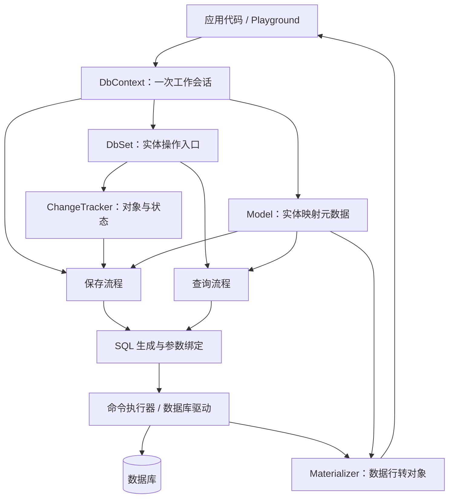

# MiniEFCore：从零写一个 ORM 框架

这个项目用于自己实现一个小型 ORM，学习框架如何认识用户的实体、跟踪对象变化、生成 SQL，以及把查询结果变回对象。项目不引用微软 Entity Framework Core；这里的 `DbContext` 和 `DbSet<T>` 都是我们自己的类型。

本文描述的是本项目的设计路线，不是 EF Core 内部实现的完整复刻。先做一个能解释清楚、能运行的最小版本，再逐步扩展。

## 1. ORM 要解决什么问题

ORM 是 Object-Relational Mapping，对象关系映射。它在 C# 对象和关系型数据库之间建立对应关系：

| C# 世界 | 数据库世界 |
|---|---|
| 实体类 `TaskItem` | 表 `TaskItems` |
| 属性 `Title` | 列 `Title` |
| 一个 `TaskItem` 对象 | 一行记录 |
| 主键属性 `Id` | 主键列 `Id` |

框架要完成两个方向的转换：

```text
写入：对象及其变化 → 数据库命令和参数 → INSERT / UPDATE / DELETE
读取：查询条件 → SELECT → 数据行 → C# 对象
```

我们自己负责这些转换。数据库驱动负责与数据库通信，数据库引擎负责真正存储数据、执行 SQL 和管理事务。手写 ORM 不要求同时手写数据库驱动和数据库引擎。

## 2. 项目里的两个角色

```text
MiniEFCore/
├── MiniEFCore.slnx
├── src/
│   └── MiniEFCore/                 框架：可供不同应用使用
│       ├── DbContext.cs
│       └── DbSet.cs
└── samples/
    └── MiniEFCore.Playground/      使用者：验证框架行为
        ├── AppDbContext.cs
        ├── TaskItem.cs
        └── Program.cs
```

框架项目不应该引用 Playground，也不应该把 `TaskItem` 写死在实现里。它应当能处理符合约定的任意实体类型。Playground 引用框架，声明实体，然后调用框架 API。

`AppDbContext` 是应用提供的配置入口；`DbContext` 是我们实现的公共基类。两者通过继承和普通方法调用连接。

## 3. 大框架：各模块负责什么



| 模块 | 核心问题 | 第一版的职责 |
|---|---|---|
| `DbContext` | 谁把所有模块组织起来？ | 持有配置、模型、集合缓存和跟踪器，提供 `Set<T>()`、`SaveChanges()` |
| `DbSet<T>` | 应用如何操作某类实体？ | 提供 `Add`、`Remove`、`Find` 等入口，委托给 Context 的内部服务 |
| 模型发现与构建 | 框架怎么认识用户定义的类？ | 反射发现实体和属性，应用主键、表名等约定 |
| 模型元数据 | 发现的信息存在哪里？ | 描述实体类型、表名、列、主键和属性访问方式 |
| `ChangeTracker` | 哪些对象要插入、修改或删除？ | 记录对象引用、实体状态，后续保存原始值快照 |
| SQL 生成器 | 如何把操作转换成 SQL？ | 根据映射生成参数化的插入、更新、删除和简单查询命令 |
| 命令执行器 | 谁负责连接数据库并执行？ | 使用数据库驱动执行命令、管理参数、事务和资源 |
| `Materializer` | 查询结果怎么变回对象？ | 创建实体，把数据列的值转换并写入属性 |

可以先让这些模块很小，不必为每个类都增加接口。等出现第二种实现或测试隔离需求，再提取接口。

## 4. 注册、反射、回调和触发分别发生在哪里

### 4.1 注册是可选的对象组装方式

第一版不需要先实现 `AddDbContext` 或依赖注入容器。直接 `new AppDbContext(...)`，就能验证 ORM 的核心功能。以后接入 DI，只是让容器负责创建和释放 Context。

注册负责保存创建规则；调用 Context 的方法负责执行操作。注册本身不会自动查询数据库。

### 4.2 反射负责发现类型结构

应用声明：

```csharp
public DbSet<TaskItem> TaskItems => Set<TaskItem>();
```

这是后续目标写法，目前骨架尚未实现 `Set<T>()`。

模型发现器读取 `AppDbContext` 的属性信息，找到 `DbSet<>` 类型的属性，再提取泛型参数 `TaskItem`。读取属性元数据并不需要执行这个属性的 getter。

之后检查 `TaskItem` 的属性，把支持的属性纳入映射。第一版只支持简单标量属性和单一主键，暂不处理导航属性、继承映射和复合主键。

### 4.3 约定把类型信息转换成数据库含义

第一版可以自行规定：

- `DbSet` 属性名作为默认表名，例如 `TaskItems`。
- 实体属性名作为默认列名，例如 `Title`。
- 优先使用 `Id` 作为主键，否则尝试 `类型名 + Id`。
- 没有主键、出现歧义或不支持的映射时，在模型构建阶段报出明确错误。

最终得到一份模型，概念上类似：

```text
EntityMetadata
  ClrType: TaskItem
  TableName: TaskItems
  PrimaryKey: Id
  Properties:
    Id          → Id          → Guid
    Title       → Title       → string
    IsCompleted → IsCompleted → bool
```

模型描述的是类型结构，不保存某条任务的业务数据。对象实例及其数据属于跟踪器管理的内容。

### 4.4 回调和虚方法提供扩展点

后续可以支持 `options => ...` 这种配置回调：保存一个委托，在准备配置时调用它。也可以提供可重写的 `OnModelCreating`，在模型构建时调用，让使用者覆盖默认映射。

这些功能都需要我们明确实现调用位置。一个方法不会仅因为名字叫 `OnModelCreating` 就自动执行。

### 4.5 方法调用触发后续工作

```text
读取 context.TaskItems
    → 执行 getter
    → 调用我们写的 Set<TaskItem>()
    → 返回绑定到当前 Context 的 DbSet<TaskItem>

调用 DbSet.Add(entity)
    → 调用跟踪器
    → 记录对象并标记 Added

调用 context.SaveChanges()
    → 获取待保存对象
    → 使用映射生成命令
    → 执行数据库写入
```

反射是读取结构的工具，不是触发操作的监听器。第一版不需要动态代理；直接使用普通方法调用，后续通过原始值快照比较发现属性修改。

模型可以在首次需要时建立并缓存。第一版先按 Context 实例保存；后续若跨实例缓存，必须明确缓存键和模型配置是否会变化，不能随意复用不同配置下的模型。

## 5. 写入流程：Add 到 SaveChanges

下面是目标 API，当前尚未实现：

```csharp
var task = new TaskItem { Title = "实现自己的 ORM" };

context.TaskItems.Add(task);
context.SaveChanges();
```

`Add` 先记录意图，不立即发送 INSERT：

```text
TrackedEntry
  Entity: task 对象的引用
  Metadata: TaskItem 的映射
  State: Added
```

`SaveChanges` 才执行保存：

1. 收集需要保存的实体，后续加入自动检测修改。
2. 根据实体状态选择 INSERT、UPDATE 或 DELETE。
3. 根据映射取得表名、列名，并读取对象当前值。
4. 生成 SQL 和参数，交给执行器。
5. 一批保存操作放在事务中，全部成功后提交。
6. 提交成功后更新跟踪状态；失败时回滚并向调用方抛出异常。

例如，命令内容与值分开：

```sql
INSERT INTO TaskItems (Id, Title, IsCompleted)
VALUES (@p0, @p1, @p2);
```

```text
@p0 = task.Id
@p1 = task.Title
@p2 = task.IsCompleted
```

实体值必须通过数据库参数传入。表名、列名来自受控映射，并由具体数据库规则进行标识符引用；不能用参数代替表名，也不能直接拼接外部输入。

第一版沿用应用生成的 Guid 主键，先避开数据库生成主键及回填机制。映射知道哪个属性是主键，不代表它自动知道如何生成主键。

## 6. 查询流程：数据库行到对象

先实现简单的 `Find(id)`，不从完整 LINQ 翻译器起步。

```text
context.TaskItems.Find(id)
    → 读取 TaskItem 的表和主键映射
    → 生成带主键参数的 SELECT
    → 执行命令并读取数据行
    → Materializer 创建 TaskItem
    → 转换并设置 Id、Title、IsCompleted
    → 返回对象；没有数据则返回 null
```

第一版可以要求实体具有公共无参构造函数、映射属性具有公共 setter。读取时要处理 `DBNull`、可空属性，以及数据库类型与 CLR 类型的转换。

第一版查询可以不跟踪结果；加入“查询后直接修改再保存”时，需要进一步实现：

- 查询对象加入跟踪器，并保留原始值快照。
- 按实体类型和主键维护身份映射，避免同一 Context 中同一行被重复跟踪为不同对象。
- `SaveChanges` 比较原始值与当前值，找出需要更新的属性。

## 7. 变更跟踪的最小状态模型

| 状态 | 含义 | 保存行为 |
|---|---|---|
| `Detached` | 当前 Context 未跟踪 | 不参与保存 |
| `Added` | 待插入 | INSERT |
| `Unchanged` | 已跟踪，当前没有变化 | 不写入 |
| `Modified` | 已跟踪，数据已修改 | UPDATE |
| `Deleted` | 待删除 | DELETE |

第一步只实现 `Added`，做通插入流程。之后再处理状态转换，例如：新增但尚未保存的对象被删除，应取消插入，而不是向数据库发送 DELETE。

不要把 `DbSet<T>` 简单当成一个 `List<T>`。数据库可能包含大量尚未加载的数据；DbSet 是操作入口，跟踪器只管理本次 Context 接触到的部分对象。

## 8. 实现顺序与完成标准

| 阶段 | 实现内容 | 如何判断完成 |
|---|---|---|
| 1. 实体发现 | 扫描 `DbSet<T>`，提取实体属性和主键 | 输出 `TaskItems → TaskItem` 及其属性；缺少主键时明确报错 |
| 2. 模型与集合 | 定义元数据，实现 `Set<T>()` 和集合缓存 | 同一 Context 多次获取同类集合得到同一实例；不同 Context 不混用集合 |
| 3. 跟踪新增 | 定义状态和跟踪条目，实现 `Add` | 调用 Add 后能看到 Added 条目，尚未执行 SQL |
| 4. 插入命令 | 根据模型生成 INSERT 和参数 | 表名、列名和值正确，含引号的文本仍作为参数处理 |
| 5. 真正持久化 | 接入一个驱动、连接与事务 | 保存后用新 Context 查询或独立 SQL 验证数据确实存在 |
| 6. 简单查询 | 实现 Find 和数据行到对象的转换 | 能按主键读取；查不到返回 null；属性转换正确 |
| 7. 修改和删除 | 快照比较、身份映射、UPDATE、DELETE | 查出对象后修改并保存有效；同一行不会重复跟踪 |
| 8. 可用性 | 异步、取消、配置入口、DI 集成 | 生命周期和失败行为清晰，不泄漏连接等资源 |
| 9. 查询表达式 | 逐步支持表达式树和有限 LINQ | 明确支持的查询子集，不支持的表达式给出错误 |

第 5 阶段建议用本地 SQLite 文件验证完整流程，只引入 SQLite 数据库驱动，不引入 EF Core。这个选择可以稍后调整；目前尚未添加数据库包。

早期可以手写建表 SQL。迁移系统、关联加载、动态代理、数据库提供程序抽象和完整 LINQ 支持属于后续扩展，不作为第一个可运行版本的前提。

## 9. 当前已完成与下一步

当前已经有：

- .NET 10 解决方案和框架类库。
- 自定义的空 `DbContext`、`DbSet<T>` 类型。
- 引用类库的 Playground、示例 `AppDbContext` 和 `TaskItem`。

当前还没有实体发现、映射、变更跟踪、数据库连接或增删改查实现。Playground 目前只输出学习提示，不表示 ORM 已经工作。

运行骨架：

```bash
cd /Users/zidiyao/Documents/Projects/MiniEFCore
dotnet build MiniEFCore.slnx
dotnet run --project samples/MiniEFCore.Playground
```

下一步从实体发现开始：先在 Playground 观察反射得到的类型信息，再把通用逻辑提取进框架。完成后新增另一个实体，验证框架能自动发现它，而不必修改针对 `TaskItem` 写死的代码。
